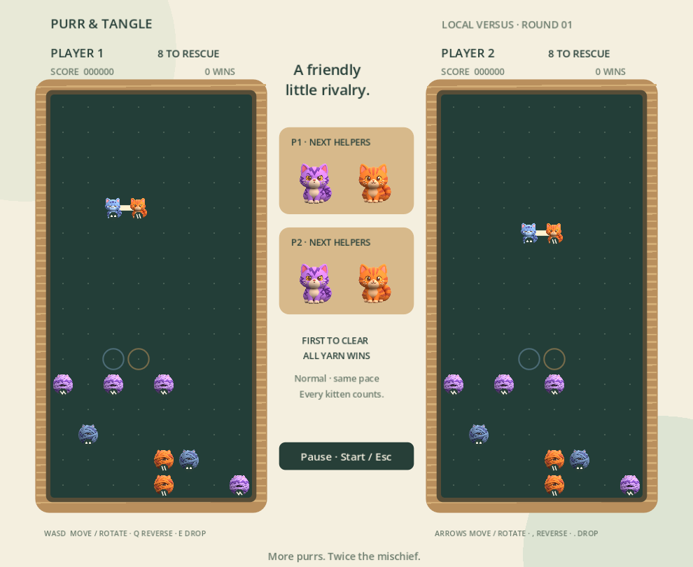

# Purr & Tangle

A cozy falling-pair puzzle built in Godot. Match four cats or yarn tangles of
one color to rescue the kittens. Play solo or race a friend in local versus.

**[Download the latest release](https://github.com/kilo666mj/purr-and-tangle/releases/latest)**
— Windows and Linux (x64), macOS (Intel + Apple Silicon).
Extract the entire archive and open the game. Godot, Blender and API keys are
not needed to play. See the included `PLAYING.txt` for platform instructions;
Windows builds are unsigned and macOS builds are not Apple-notarized.

## Screenshots

| Solo | Local two-player versus |
| --- | --- |
|  |  |

## How to play

- Match four or more of one color horizontally or vertically.
- Yarn stays fixed; unsupported cats fall and can start chain reactions.
- Clear all yarn to finish a basket. In versus, clear yours first or outlast
  the other player's full basket.
- Choose **Relaxed**, **Normal**, or **Spicy**. The pace increases every 20
  seconds of play; the speed display shows the next increase.

| Action | Solo keyboard | Controller |
| --- | --- | --- |
| Move / soft drop | Arrows | D-pad / left stick |
| Rotate / reverse | Up / Z | A / B |
| Hard drop | Space | X |
| Pause | Esc / P | Start |

For versus, press **A on each controller** to join. Keyboard players choose
**F1** for P1 (**WASD / Q / E**) and **F2** for P2 (**arrows / comma / period**).
Both players get the same layouts, pairs, difficulty and speed.

Sound, reduced motion and pattern cues are in the pause menu. Settings and
best solo score are saved locally; unfinished baskets are not.

## Development

Open `project.godot` in **Godot 4.7.2** and press F5, or follow the
[development guide](docs/DEVELOPMENT.md) for setup, tests, full controls,
difficulty values, release builds and asset rendering.

## License and security

[MIT](LICENSE). Included artwork is listed in the
[asset inventory](assets/provenance.json). See [SECURITY.md](SECURITY.md)
for security reporting and checks.
