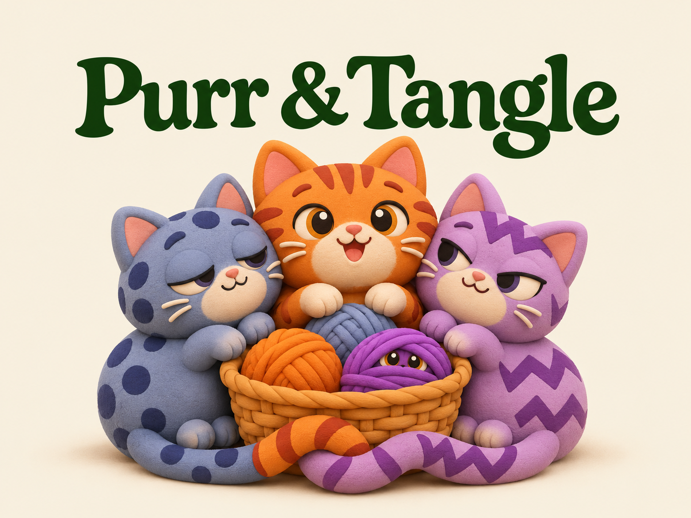

# Purr & Tangle

A cozy falling-pair puzzle built in Godot. Match four cats or yarn tangles of
one color horizontally or vertically. The yarn stays fixed; clearing it rescues
the kittens. Clear every tangle to advance to the next basket.

Play solo or race a friend in local two-player versus. Supports controllers,
shared-keyboard play, three difficulty presets, and speed that increases as
you play.



## Play

Open `project.godot` in Godot 4.7.2 and press F5, or run:

```sh
git clone https://github.com/kilo666mj/purr-and-tangle.git
cd purr-and-tangle
bash scripts/install_godot.sh
bash scripts/run.sh
```

The portable Linux engine can be downloaded into the ignored `.tools/` folder
with `bash scripts/install_godot.sh`. Set `GODOT_BIN` to use another installation.
The first version targets desktop, with a resizable window, keyboard, controller,
and clickable on-screen controls. The game starts maximized with normal window
controls; restoring it gives a 990×810 window. The orange cat is the
application/window icon. An original cat-and-yarn splash replaces the Godot
startup logo without adding a forced loading delay.
Settings, difficulty selection, and the best solo score persist locally;
individual runs and versus win tallies start fresh when the game closes.

No API keys, Meshy account, Blender installation, or paid services are needed
to play. Generated artwork and model renders are included. Blender and Meshy
are optional tools for rebuilding or extending the artwork.

| Action | Keyboard | Controller (standard layout) |
| --- | --- | --- |
| Move | Left/right arrows or A/D | D-pad or left stick |
| Rotate clockwise | Up, W or X | A / south button |
| Rotate counterclockwise | Z | B / east button |
| Soft drop | Down or S | D-pad/stick down |
| Hard drop | Space | X / west button |
| Pause/resume | Esc or P | Start |
| Menu navigation | Arrow keys | D-pad |
| Menu selection | Enter | A / south button |
| Mute | M or pause menu | Pause menu |

Pause also freezes pending chain reactions. Losing window focus or disconnecting
a controller pauses play. The pause menu provides mute, reduced motion, pattern
cues, and restart. Stripes, spots, and zigzags identify the three colors without
depending on color alone. Darker markings on a piece are decorative: each cat
and each yarn ball has exactly one matching color. Falling pairs may contain
two different colors.

## Local two-player versus

Choose **Local two-player versus** on the title screen. Press A on each of two
different controllers to join; press Start or select **Start the race** when
both players are ready. Controller assignments stay fixed for the match, and
a third controller cannot interfere. B releases a controller's slot in the lobby.

Two controllers, keyboard plus controller, and a shared keyboard are supported.
Choose keyboard slots with the lobby buttons or F1 (P1) / F2 (P2):

| Action | Player 1 keyboard | Player 2 keyboard | Each controller |
| --- | --- | --- | --- |
| Move | A / D | Left / right | D-pad or left stick |
| Rotate clockwise | W | Up | A |
| Rotate counterclockwise | Q | Comma | B |
| Soft drop | S | Down | D-pad/stick down |
| Hard drop | E | Period | X |
| Pause | Esc / P | Esc / P | Start |

Both players receive identical yarn layouts and the same sequence of pairs,
even if one drops faster. A three-second countdown starts each round. Clear all
your yarn first, or win when the other basket fills up. Simultaneous clears or
simultaneous losses are a draw. Rematches retain wins and controller assignments
and advance both players to the next, faster basket. This is a local race mode;
online play and attacks that send pieces to the other basket are not implemented.

Pausing, losing window focus, or disconnecting an assigned controller freezes
both baskets, including countdowns and chains. Press A on a replacement
controller, or choose the missing player's keyboard, before resuming. Returning
to the main menu ends the match; unfinished baskets are not saved.

## Difficulty and speed

Select a difficulty on the title screen or in the versus lobby. It is remembered
locally. Both versus players always share the same preset, and it stays fixed
through level progression and rematches.

| Preset | Starting yarn | Starting fall interval |
| --- | --- | --- |
| Relaxed | 4 | 1.05 seconds per row |
| Normal | 8 | 0.85 seconds per row |
| Spicy | 12 | 0.65 seconds per row |

Every 20 seconds of active play, the natural fall interval becomes 15% shorter,
down to a 180 ms minimum. On Normal, that is 850 ms initially, 723 ms after
20 seconds, 614 ms after 40 seconds, and 522 ms after a minute. The **SPEED**
indicator shows the current rate relative to the basket's starting pace, counts
down to the next increase, and displays **MAX** at the cap.

The timer includes clearing and chain reactions, but stops for pauses, menus,
and the opening countdown. Versus uses one shared timer so both players speed
up together, regardless of how quickly either player drops or clears pieces.

Each new basket adds two yarn tangles (up to 52), shortens the starting fall
interval by 45 ms, and restarts the 20-second timer. Soft drop stays at 55 ms
per row on every preset. Matching, rotations, and lock delay are identical.

## Rules and reproducibility

The board is 8×16. Intact pairs fall together only when both halves can move;
when one half clears, the other becomes independent. Matches clear
simultaneously, followed by gravity and additional matches. Victory is checked
before trying to spawn another pair. Each landing has a 350 ms lock delay.

The default run seed is 1729. Use another reproducible run with:

```sh
bash scripts/run.sh -- --seed=12345
```

`scripts/board.gd` contains the deterministic rules, `session.gd` handles timing
and pause, and `difficulty.gd` defines the presets. `controls.gd` maps solo inputs;
`versus_input.gd` routes each player's devices and `versus_match.gd` manages fair
rounds and outcomes. `main.gd` and `versus_screen.gd` present the modes using a
shared `board_view.gd` and `puzzle_art.gd`. Scoring is 100 per yarn and 20 per cat,
multiplied by chain depth; soft and hard drops add 1 and 2 points per row.

## Original artwork and 3D pipeline

Six original transparent source images live in `assets/sprites/`. They were
created with the built-in image generation tool. `assets/provenance.json`
records prompts, generation settings, and Meshy task IDs.

The startup illustration is `assets/ui/boot_splash.png`, also made with the
built-in image generation tool. Its exact prompt and file hash are recorded in
the `splash` entry of `assets/provenance.json`. Godot's boot splash settings in
`project.godot` scale it to fit while preserving its aspect ratio.

Each source was converted by Meshy T2.5 Smart Topology with N1 2K textures,
targeting 4,000 triangles. The six textured GLBs live in `assets/models/`.
The approved batch cost 90 credits total. No rigging or further paid operations
are needed for this prototype.

Blender renders those models into `assets/renders/`, which the game prefers over
the source artwork. Rebuild them with:

```sh
bash scripts/render_all.sh
```

This uses at most two Blender processes and a project-local sRGB color profile
for reproducible colors. No system Blender configuration is changed.

The Meshy MCP installer is `scripts/meshy_setup.py`. It reads only
`MESHY_API_KEY` from the selected local dotenv file without executing it, stores
the file path in Codex settings, and keeps the key out of command arguments and
output. `python3 scripts/meshy_setup.py check` performs a free authentication and
tool-discovery check. Generation costs credits and is separate from setup.

## Validation

```sh
bash scripts/check.sh
bash scripts/preview.sh all
```

The first command imports resources, checks scripts, exercises deterministic
rules, difficulty presets, isolated inputs, reconnects, rematches and controller
menus headlessly, and tests credential handling. The second uses Xvfb/software
OpenGL to save actual screenshots of solo play, title, versus play, lobby and
pause under `artifacts/`. Omit `all` for solo only, or pass `versus` for the three
versus screens. Desktop display access is required for capture.
Input tests inject controller events; physical controller feel and sound still
need playtesting on the target desktop.

## License

MIT — see [LICENSE](LICENSE). Artwork generation prompts and model provenance
are documented in [assets/provenance.json](assets/provenance.json).

Godot and Blender are separate tools with their own licenses; their binaries
are not included in this repository.
