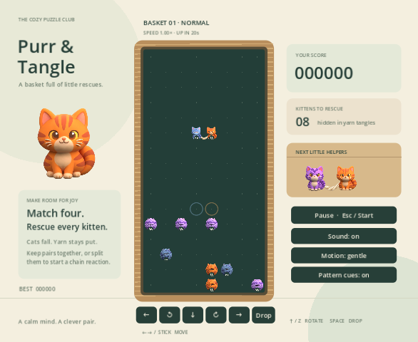
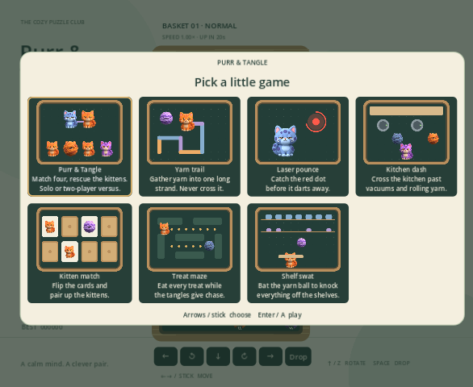
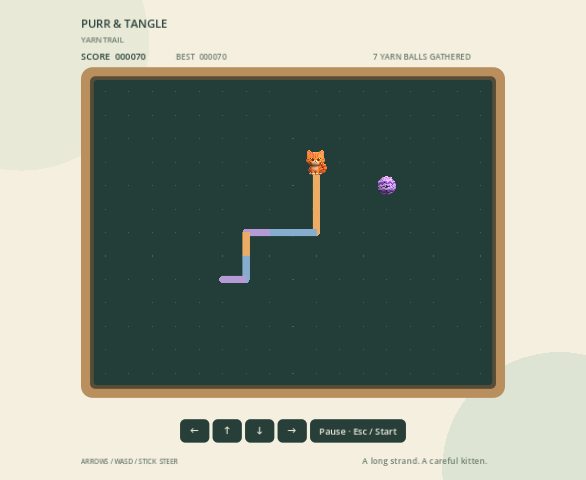
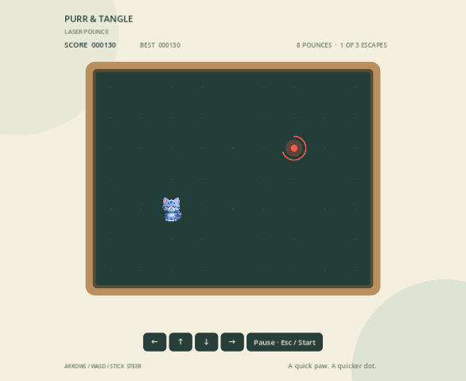
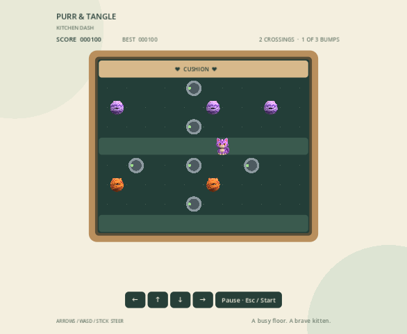
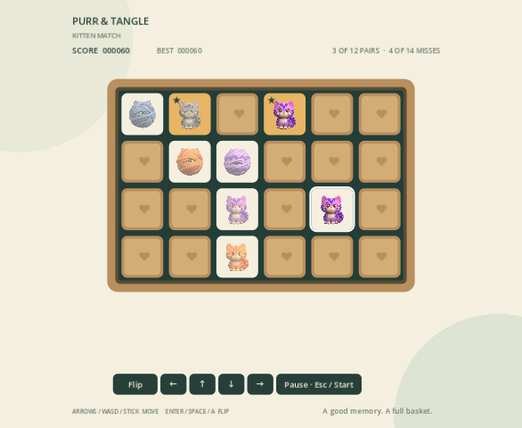
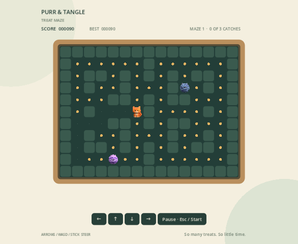
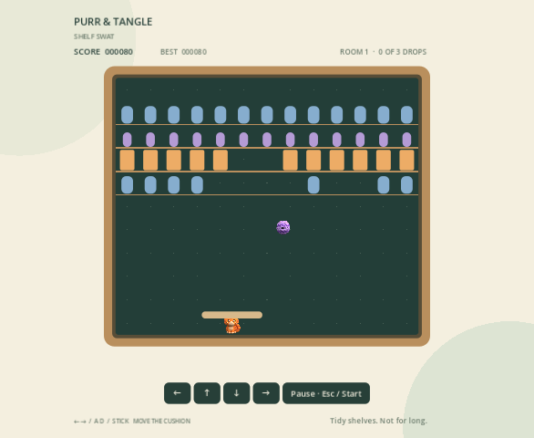

# Purr & Tangle

A cozy collection of little cat games built in Godot. The main game is a
falling-pair puzzle: match four cats or yarn tangles of one color to rescue the
kittens, solo or racing a friend in local versus. Six smaller arcade-style
games sit beside it on the opening menu.

**[Download the latest release](https://github.com/kilo666mj/purr-and-tangle/releases/latest)**
— Windows and Linux (x64), macOS (Intel + Apple Silicon).
On Windows and Linux, extract the entire ZIP and open the game; on macOS, open
the disk image and drag the app onto Applications. Godot, Blender and API keys are
not needed to play. See the included `PLAYING.txt` for platform instructions;
Windows builds are unsigned and macOS builds are not Apple-notarized.

## Screenshots

| Solo | Local two-player versus |
| --- | --- |
|  |  |

| Game menu | Yarn trail | Laser pounce |
| --- | --- | --- |
|  |  |  |

| Kitchen dash | Kitten match | Treat maze | Shelf swat |
| --- | --- | --- | --- |
|  |  |  |  |

## How to play

- Match four or more of one color horizontally or vertically.
- Yarn stays fixed; unsupported cats fall and can start chain reactions.
- Clear all yarn to finish a basket. In versus, clear yours first or outlast
  the other player's full basket.
- Choose **Relaxed**, **Normal**, or **Spicy**. The pace increases every 20
  seconds of play; the speed display shows the next increase.

| Action | Solo keyboard | Controller |
| --- | --- | --- |
| Move / soft drop | Arrows | D-pad / left stick |
| Rotate / reverse | Up / Z | A / B |
| Hard drop | Space | X |
| Pause | Esc / P | Start |

The game opens on a menu with a picture card for each game.

**Yarn trail** is a second, smaller game: steer a kitten
with the arrows, WASD, D-pad or stick to gather yarn balls. The strand behind
it grows with each one; stay inside the basket and never cross the strand.

The side games all steer with the arrows, WASD, D-pad or stick:

| Game | Goal | Ends when |
| --- | --- | --- |
| **Laser pounce** | Step onto the red dot before its ring runs out | Three dots escape |
| **Kitchen dash** | Cross the lanes of vacuums and yarn to the cushion | Three bumps |
| **Kitten match** | Flip cards (Enter / Space / A) to find twelve pairs | Fourteen misses |
| **Treat maze** | Eat every treat while two tangles chase you | Three catches |
| **Shelf swat** | Bat the yarn ball to clear the shelves | Three drops |

For versus, press **A on each controller** to join. Keyboard players choose
**F1** for P1 (**WASD / Q / E**) and **F2** for P2 (**arrows / comma / period**).
Both players get the same layouts, pairs, difficulty and speed.

Sound, reduced motion and pattern cues are in the pause menu. Settings and
best scores are saved locally. The puzzle also remembers the basket you
reached: its start screen offers to continue from there or start fresh. A
basket in progress restarts from its beginning.

## Development

Open `project.godot` in **Godot 4.7.2** and press F5, or follow the
[development guide](docs/DEVELOPMENT.md) for setup, tests, full controls,
difficulty values, release builds and asset rendering.

## License and security

[MIT](LICENSE). Included artwork is listed in the
[asset inventory](assets/provenance.json). See [SECURITY.md](SECURITY.md)
for security reporting and checks.
